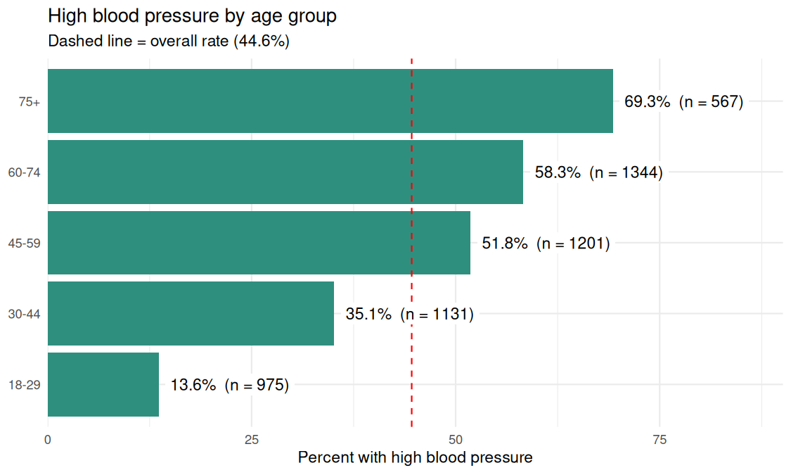
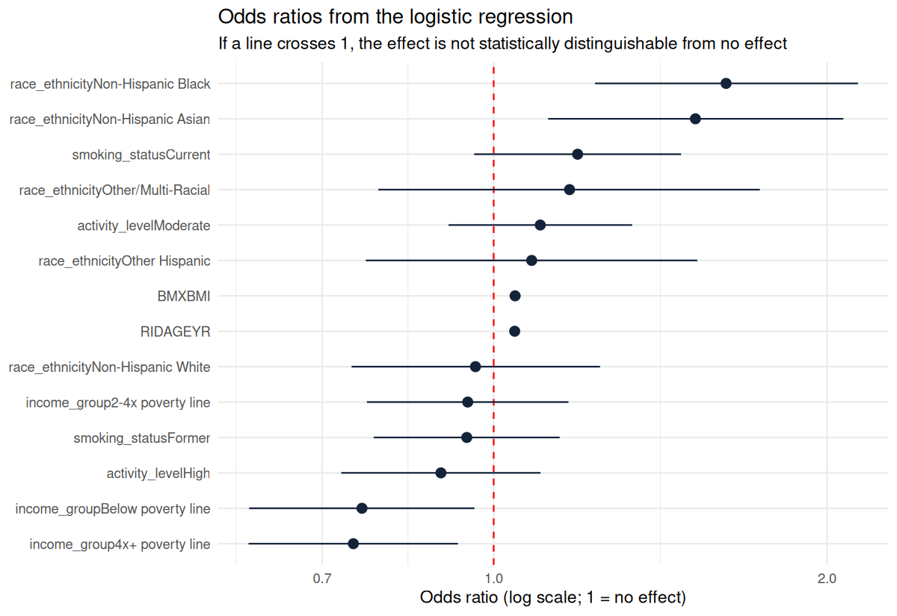

# Identifying Everyday Risk Factors for Hypertension

A team data science project (Data Science Micro-Credential, University at Buffalo), in R. Using CDC NHANES 2017–2018 survey data, we measure how hypertension risk differs by income, race/ethnicity, age and lifestyle, with a scripted, replicable pipeline and a documented data-quality log.

**Read the full report:** download [`reports/report.html`](reports/report.html) and open it in a browser. It explains the question, the data, the findings and the limitations in plain language, with a glossary for every technical term.

## Key findings

Of **5,218 U.S. adults** with a measured blood pressure, **44.6% had high blood pressure** (130/80 mmHg or higher, the 2017 ACC/AHA guideline). This matches the CDC's published figure of about 45%.

| Finding | Result |
|---|---|
| **Age** is the dominant factor | 13.6% of adults aged 18–29 versus 69.3% of those 75 and over. Each extra year raises the odds by about 4%. |
| **BMI** | Each extra BMI point raises the odds by about 5%. |
| **Race/ethnicity** | Compared with Mexican American adults, odds were 1.62 times as high for Non-Hispanic Black adults (95% CI 1.23–2.13) and 1.52 times as high for Non-Hispanic Asian adults (1.12–2.07). |
| **Income** | Irregular pattern, not a straight line; not read as poverty being protective. |
| **Smoking and activity** | No clear effect once age and the other factors are accounted for, although they look different in the raw rates. |
| **Prediction** | A logistic regression model was right for **66.7%** of people it had never seen, against a **55.5%** baseline. A real but modest improvement. It is **not a diagnostic tool**. |





## Why NHANES

We first evaluated a popular Kaggle hypertension dataset and found strong evidence it was synthetic: the same ~72% hypertension rate in every country, age and income group, and no feature related to the outcome. NHANES is real, documented survey data with an official codebook, and blood pressure is **measured** by trained staff, not self-reported.

## Pipeline

| Step | Script | Does |
|---|---|---|
| 1 | `R/01-download.R` | Downloads the NHANES 2017–2018 tables (DEMO, BPX, BMX, SMQ, PAQ) into `data/raw/`, and the CDC documentation page for each into `docs/codebook/` |
| 2 | `R/02-merge-clean.R` | Merges on `SEQN`, keeps adults, audits missing values, duplicates, implausible readings and records lost at each merge; draws the data-quality figures |
| 3 | `R/03-variables.R` | Average BP (readings 2–4), hypertension outcome (ACC/AHA 2017, 130/80 mmHg), income-to-poverty, race/ethnicity, age, smoking and activity groups |
| 4 | `R/04-analysis.R` | Hypertension rates by group, correlation, logistic regression against the no-information baseline; draws the result figures and exports the results |
| 5 | `reports/report.Rmd` | Final report: leading risk factors and the data's limitations |

## Run it

Install the packages once:

```r
install.packages(c("dplyr", "readr", "foreign", "tidyr", "tibble", "ggplot2",
                   "broom", "jsonlite", "knitr", "rmarkdown", "scales", "nhanesA"))
```

`nhanesA` is used once, to look up the race/ethnicity codes. On Linux it needs the system libraries `libcurl4-openssl-dev` and `libssl-dev` installed first. The same codes are in `docs/codebook/DEMO_J.htm`.

Then run everything from the project root:

```r
source("R/01-download.R")
source("R/02-merge-clean.R")
source("R/03-variables.R")
source("R/04-analysis.R")
rmarkdown::render("reports/report.Rmd")
```

Run the scripts in this order. Each one reads what the previous one saved in `data/clean/`.

## Layout

```
R/                pipeline scripts, numbered in run order
reports/          the final report (report.Rmd, and the rendered report.html)
docs/             data-quality-log.md, decisions.md, and codebook/ (CDC documentation)
data/raw/         downloaded by script, not committed
data/clean/       produced by script, not committed
output/           results: model coefficients, odds ratios, confusion matrix
output/figures/   all figures (prefixed 02-, 03-, 04- by the script that made them)
```

## Documentation

- [`docs/data-quality-log.md`](docs/data-quality-log.md): what the data checks found (sample loss, missing values, duplicates, implausible values).
- [`docs/decisions.md`](docs/decisions.md): every choice made when building the variables, and why.
- [`docs/codebook/`](docs/codebook/): the CDC's own definition of every variable, saved for reference.

## Data

NHANES is public: [CDC NHANES 2017–2018](https://wwwn.cdc.gov/nchs/nhanes/continuousnhanes/default.aspx?BeginYear=2017). Data files are not committed; `R/01-download.R` fetches them.

## Limitations

The analysis is unweighted (it describes this sample, not official national estimates), cross-sectional (one snapshot, so patterns not causes), and based on measured blood pressure without medication. About 13% of people did not report income and were left out of the model. The full list, tied to the choices behind each one, is in the report.

## Future work

Survey weights for national estimates, a "Not reported" income group and multiple imputation for missing income, blood pressure medication, and comparison with later NHANES cycles.


## AI use disclosure

Merveilles Katumba used Claude Code (Anthropic's AI assistant) throughout this project, for:

- checking code syntax and fixing errors
- explaining concepts and R syntax (logistic regression, odds ratios, data leakage, missing values)
- step-by-step guidance for each task.
- drafting written material: `reports/report.Rmd`, this README, `docs/data-quality-log.md`, `docs/decisions.md` and the pull request descriptions

Every line of code in `R/` was written and run by Merveilles himself, not pasted from an AI tool. He ran every script, checked the outputs against the CDC codebook, and found and fixed problems along the way, such as the missing-BMI bug that produced an `NA` accuracy. The drafted documents were reviewed and edited by him before being committed, and the numbers in them come from his own script outputs.

The research question, the choice of NHANES over the Kaggle dataset, and the decisions about how to define and handle the variables were the team's and are recorded in `docs/decisions.md`.

## Team

| Member | Role |
|---|---|
| Merveilles Katumba | Data Scientist |
| Uma Bhattacharjee | Scribe |
| Vedant Saxena | Project Lead and Communication Liaison |
| Raiyan Arian | Data Architect |

## License

MIT. See [`LICENSE`](LICENSE).