```{r setup, include=FALSE}
knitr::opts_chunk$set(echo = TRUE, warning = FALSE, message = FALSE)

library(dplyr)
library(broom)
library(knitr)

# Everything below is read from files the pipeline already produced (R/01 to R/04).
# This report only narrates those results; it does not recompute the whole project.
nhanes  <- readRDS("../data/clean/nhanes_adults_clean.rds")
model   <- readRDS("../data/clean/model.rds")
results <- jsonlite::read_json("../output/segmented_results.json", simplifyVector = TRUE)
cm      <- read.csv("../output/confusion_matrix.csv")
```

```{r numbers, include=FALSE}
# Small helpers for formatting numbers inside sentences
fmt <- function(x) format(x, big.mark = ",")
pct <- function(x, d = 1) paste0(round(x * 100, d), "%")

# The sample
n_final  <- nrow(nhanes)
n_high   <- sum(nhanes$hypertension == "High")
n_low    <- sum(nhanes$hypertension == "Low")
pct_high <- round(n_high / n_final * 100, 1)
pct_low  <- round(n_low / n_final * 100, 1)
n_income_missing <- sum(is.na(nhanes$income_group))

# The model sample
n_train <- nobs(model)
n_test  <- sum(cm$Freq)
n_model <- n_train + n_test

# The confusion matrix: tn = correctly said Low, tp = correctly said High,
# fp = false alarm (said High, actually Low), fn = missed case (said Low, actually High)
tn <- cm$Freq[cm$Predicted == 0 & cm$Actual == 0]
fn <- cm$Freq[cm$Predicted == 0 & cm$Actual == 1]
fp <- cm$Freq[cm$Predicted == 1 & cm$Actual == 0]
tp <- cm$Freq[cm$Predicted == 1 & cm$Actual == 1]

accuracy      <- (tn + tp) / n_test
sensitivity   <- tp / (tp + fn)
specificity   <- tn / (tn + fp)
baseline      <- results$baseline_accuracy
test_majority <- max(tn + fp, fn + tp) / n_test

# Odds ratios from the model, with a helper to look one up by name
or_tbl <- tidy(model, exponentiate = TRUE, conf.int = TRUE)
get_or <- function(term) round(or_tbl$estimate[or_tbl$term == term], 2)
get_ci <- function(term) {
  r <- or_tbl[or_tbl$term == term, ]
  paste0(round(r$conf.low, 2), " to ", round(r$conf.high, 2))
}
age_decade <- round(exp(10 * coef(model)["RIDAGEYR"]), 2)
bmi_5pts   <- round(exp(5 * coef(model)["BMXBMI"]), 2)

# Correlations with the outcome
cors <- nhanes %>%
  mutate(high = if_else(hypertension == "High", 1, 0)) %>%
  select(RIDAGEYR, BMXBMI, avg_systolic, avg_diastolic, high) %>%
  cor(use = "complete.obs")
cor_age <- round(cors["RIDAGEYR", "high"], 2)
cor_bmi <- round(cors["BMXBMI", "high"], 2)
```

# Summary

High blood pressure, called **hypertension**, affects nearly half of adults in the United States. It often has no symptoms, yet it raises the risk of heart disease and stroke. This project asks a simple question:

> **Which everyday factors, such as age, body weight, smoking, physical activity, income and race/ethnicity, are linked to high blood pressure, and how well can those factors predict it?**

**The data.** We used real health survey data collected by the U.S. Centers for Disease Control and Prevention (CDC) in 2017–2018, called NHANES. In this survey, trained staff measure each person's blood pressure. After cleaning, our sample is **`r fmt(n_final)` adults**. Using the current U.S. medical guideline (130/80 mmHg), **`r fmt(n_high)` of them (`r pct_high`%) had high blood pressure**. The CDC's own published figure for the same period is about 45%, so our sample behaves as it should.

**Key findings**

1. **Age is by far the strongest factor.** The share with high blood pressure rises from 13.6% among adults aged 18–29 to 69.3% among those 75 and older. Each extra year of age raises the odds by about `r round((get_or("RIDAGEYR") - 1) * 100)`%, which is roughly `r round((age_decade - 1) * 100)`% higher odds for every ten years.
2. **Higher body mass index (BMI) is linked to higher blood pressure.** Each extra BMI point goes with about `r round((get_or("BMXBMI") - 1) * 100)`% higher odds.
3. **Race and ethnicity show differences.** Compared with Mexican American adults, the odds were `r get_or("race_ethnicityNon-Hispanic Black")` times as high for Non-Hispanic Black adults and `r get_or("race_ethnicityNon-Hispanic Asian")` times as high for Non-Hispanic Asian adults.
4. **Income shows an irregular pattern.** Adults at 4 or more times the poverty line and those below the poverty line both had lower odds than the 1–2x group. We do not read this as poverty being protective (see Section 7).
5. **Smoking and physical activity are not clearly linked once age is taken into account.** They look different in the raw numbers, but the gap mostly disappears when the model compares people of the same age.
6. **A model built from these factors is only modestly accurate.** It was right for **`r pct(accuracy)`** of people it had never seen, compared with **`r pct(baseline)`** for simply guessing the more common answer. It is a useful way to study patterns, but it is **not a diagnostic tool**.

**What this means in practice.** Our results describe patterns in one survey. They show which groups tend to have higher blood pressure, not why. Section 9 explains the main limitations.

# How to Read This Report

- Each section starts with a plain-language explanation. Technical terms are explained where they first appear, and all of them are collected in the **Glossary** (Section 12).
- The R code is hidden by default. Click **Code** at the top of the page, or the **Code** buttons next to each result, if you want to see how a number was produced.
- Every number in the text is calculated from the project's data files when the report is built, so the text and the figures always agree.

| If you want to know… | Go to |
|---|---|
| What the project found | Section 1 (Summary) and Section 7 (Ranked Findings) |
| Where the data came from and how good it is | Sections 3 and 4 |
| How "high blood pressure" was defined | Section 5 |
| How well the model predicts | Section 8 |
| What the results cannot tell us | Section 9 |

# Background

## The question

Doctors and public-health researchers know that blood pressure tends to rise with age and body weight. Less is known about how much everyday and social factors, such as smoking, exercise, income and race/ethnicity, add once those basics are accounted for. This project looks for those links in real survey data and tests whether they are strong enough to predict who has high blood pressure.

## What "high blood pressure" means

Blood pressure is written as two numbers in **millimetres of mercury (mmHg)**:

- **Systolic pressure** (the top number) is the pressure in the arteries when the heart beats.
- **Diastolic pressure** (the bottom number) is the pressure between beats.

We used the 2017 American College of Cardiology and American Heart Association guideline: a person has **high blood pressure** if their systolic pressure is **130 or higher**, or their diastolic pressure is **80 or higher**. An older guideline used 140/90. It is also a valid choice, but it labels fewer people as High.

# The Data

## Where it comes from

The data come from **NHANES**, the National Health and Nutrition Examination Survey, run by the CDC's National Center for Health Statistics. NHANES combines interviews with a physical examination, so blood pressure and body measurements are **measured**, not just self-reported. We used the 2017–2018 cycle, which is the most recent complete cycle before the COVID-19 pandemic disrupted data collection.

We downloaded five tables directly from the CDC and kept the CDC's own documentation for each in `docs/codebook/`:

| Table | What it contains |
|---|---|
| `DEMO_J` | Demographics: age, sex, race/ethnicity, household income |
| `BPX_J` | Blood pressure examination (up to four readings per person) |
| `BMX_J` | Body measurements, including body mass index (BMI) |
| `SMQ_J` | Smoking questionnaire |
| `PAQ_J` | Physical activity questionnaire |

## From survey respondents to our sample

The five tables were linked using each person's unique ID. A person stays in the analysis only if they appear in **all five** tables. This is why the sample shrinks from 9,254 people interviewed to 5,533 adults.

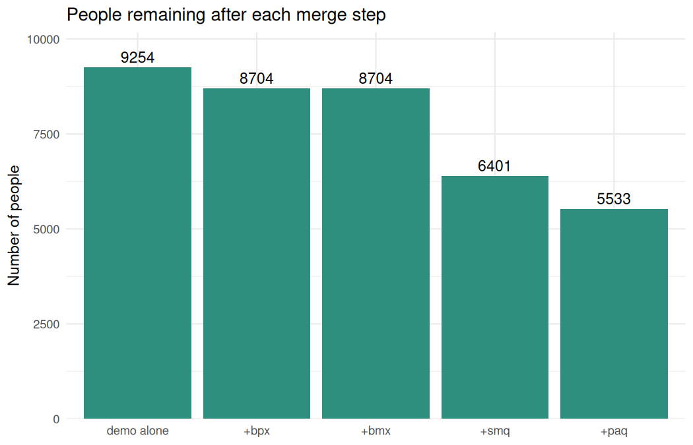{width=85%}

Of the 5,533 adults, `r fmt(5533 - n_final)` had no valid blood pressure reading and were removed, leaving **`r fmt(n_final)`** people.

## How complete is the data?

Not every person answered every question. The chart below shows the share of people missing each variable.

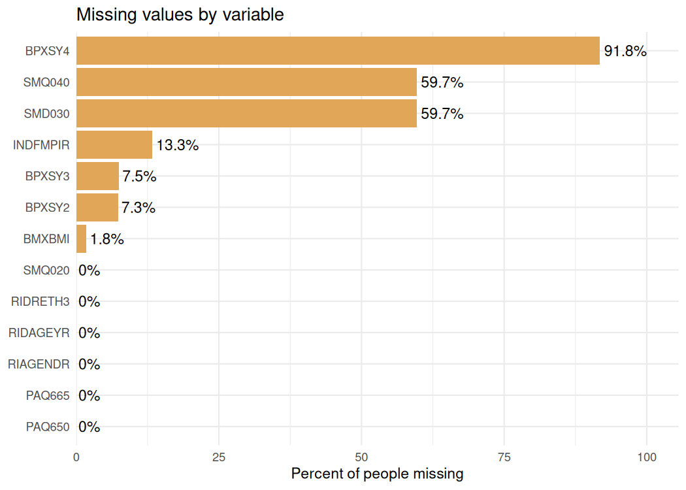{width=85%}

Most gaps are explained by how the survey works:

- The **fourth** blood pressure reading is missing for about 92% of people, because a fourth reading is only taken when earlier ones were incomplete.
- The smoking follow-up questions are missing for about 60%, because they are only asked of people who have ever smoked.
- **Household income is the one gap that matters:** `r fmt(n_income_missing)` people (`r round(n_income_missing / n_final * 100, 1)`%) did not report it. We discuss how this was handled in Section 9.

## Checking that the values make sense

We checked for duplicate people (none) and for impossible values. Age and blood pressure passed, with one exception worth knowing about. **33 people have a diastolic reading of 0 mmHg**, which is not physically real. We tested whether this mattered by treating those zeros as missing and recalculating everyone's High/Low label. **No label changed**, so the readings were kept, and the limitation is recorded. Two people have a BMI above 80, which is extremely rare but possible, so they were flagged and kept. The full record is in `docs/data-quality-log.md`.

## What the measurements look like

The histograms below show how common each value is. A **histogram** groups values into bins, and the height of each bar shows how many people fall in that bin.

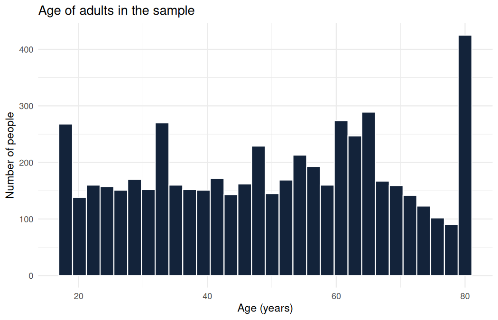{width=80%}

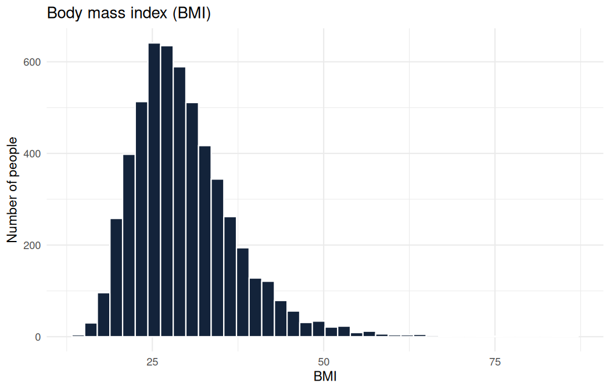{width=80%}

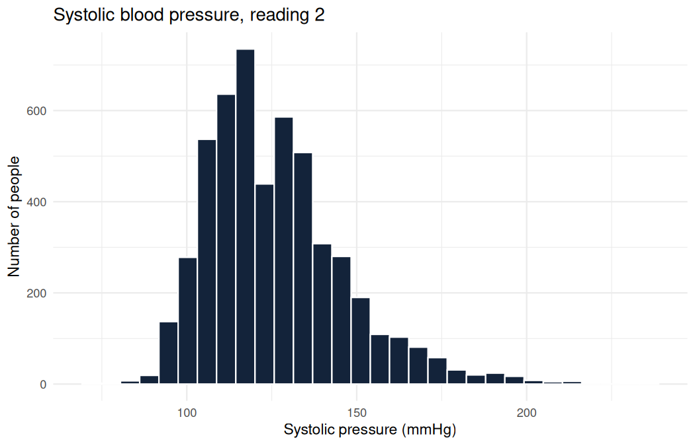{width=80%}

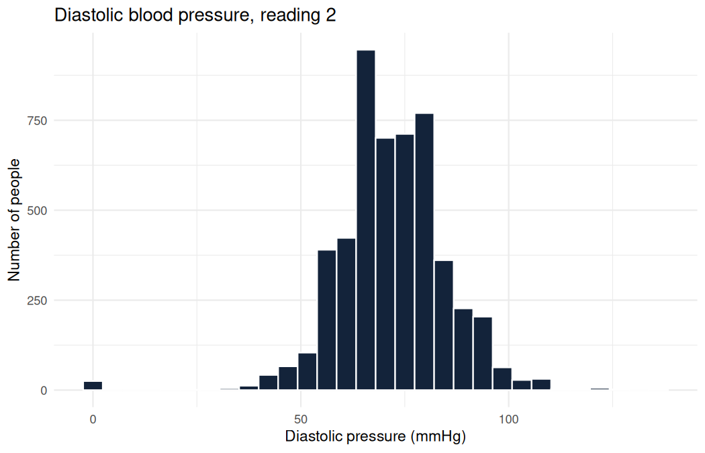{width=80%}

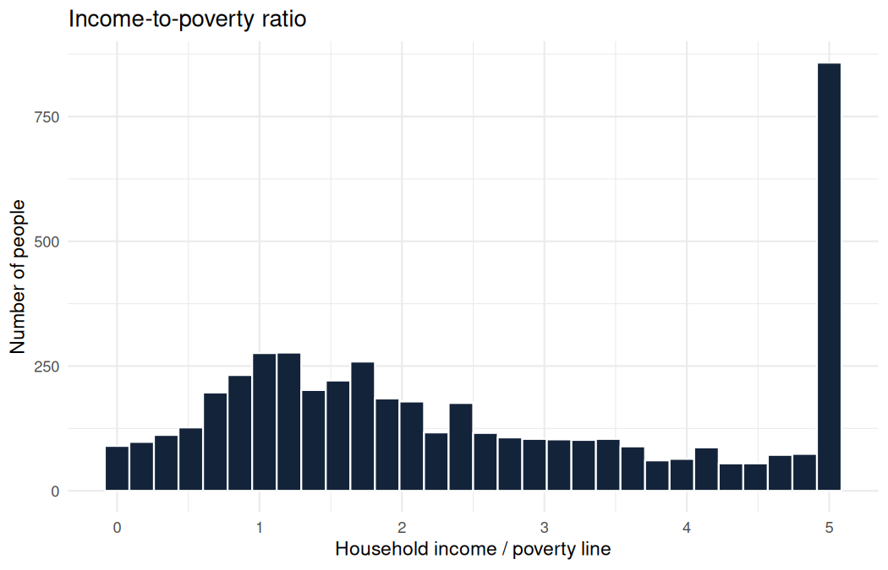{width=80%}

The scatter plot below shows each person as a dot. As a sanity check, diastolic pressure should always be lower than systolic pressure, so every dot should sit below the red line. They do. The row of dots along the bottom is the zero readings.

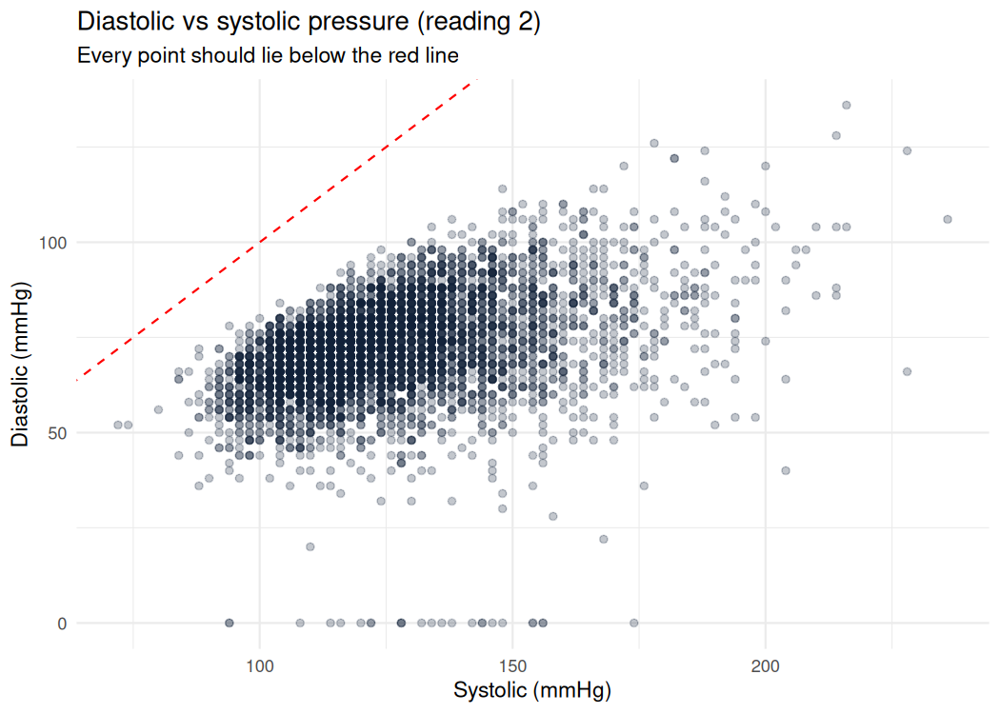{width=80%}

# Building the Variables

The raw survey stores answers as numeric codes. We turned them into readable variables, checking each code against the CDC's codebook. All choices are recorded in `docs/decisions.md`.

| Variable | How it is defined |
|---|---|
| **High blood pressure** | Average systolic pressure of 130 or more, or average diastolic of 80 or more, using readings 2 to 4. Reading 1 is skipped because the first reading tends to run high. |
| **Smoking status** | **Never** (under 100 cigarettes in life), **Former** (smoked 100 or more but not now), **Current** (smokes every day or some days) |
| **Activity level** | **High** (vigorous recreational activity), **Moderate** (moderate but not vigorous), **Low** (neither) |
| **Race/ethnicity** | Six groups from the CDC variable `RIDRETH3` |
| **Income group** | Based on the **income-to-poverty ratio**: household income divided by the poverty line for that household size. Groups: below 1x, 1–2x, 2–4x and 4 or more times the poverty line |
| **Age group** | 18–29, 30–44, 45–59, 60–74, 75 and older |

```{r outcome-table}
kable(
  data.frame(
    `Blood pressure` = c("High", "Low"),
    People = c(fmt(n_high), fmt(n_low)),
    Share = c(paste0(pct_high, "%"), paste0(pct_low, "%")),
    check.names = FALSE
  ),
  caption = "The outcome in the final sample."
)
```

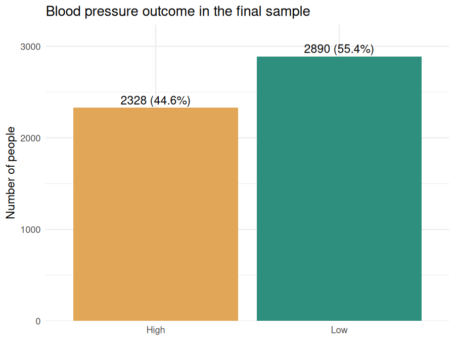{width=60%}

Two caveats about the outcome. First, it is based on **measured blood pressure only**, and takes no account of medication. A person whose blood pressure is controlled by medication is labelled Low. So our outcome means "elevated blood pressure at the time of the exam", not "has a doctor's diagnosis". Second, our activity measure covers recreational activity only, so a person with a physically demanding job but no exercise is classed as Low.

# Exploring the Data: Who Has High Blood Pressure?

Before building any model, we compared the share of people with high blood pressure across groups. The overall rate is **`r pct_high`%**, shown as the dashed red line in each chart below. Each bar also shows the number of people in that group (n), because a percentage from a small group is less reliable than one from a large group.

```{r group-rates}
rate_by <- function(data, col, label) {
  data %>%
    filter(!is.na(.data[[col]])) %>%
    group_by(Group = as.character(.data[[col]])) %>%
    summarise(People = n(),
              `High blood pressure (%)` = round(mean(hypertension == "High") * 100, 1),
              .groups = "drop") %>%
    mutate(Factor = label) %>%
    select(Factor, Group, People, `High blood pressure (%)`) %>%
    arrange(desc(`High blood pressure (%)`))
}

all_rates <- bind_rows(
  rate_by(nhanes, "age_group", "Age group"),
  rate_by(nhanes, "race_ethnicity", "Race/ethnicity"),
  rate_by(nhanes, "income_group", "Income group"),
  rate_by(nhanes, "smoking_status", "Smoking status"),
  rate_by(nhanes, "activity_level", "Activity level")
)

kable(all_rates, caption = "Share of people with high blood pressure, by group.")
```

## Age

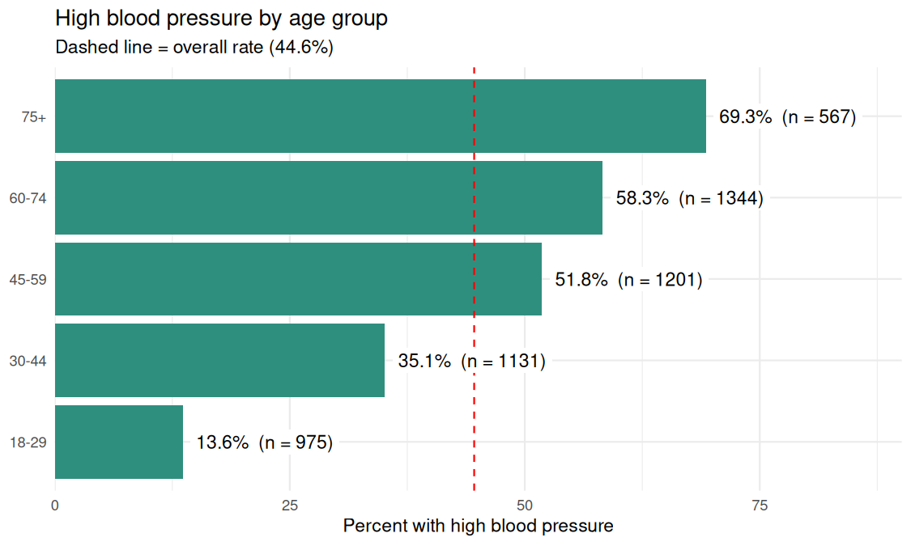{width=85%}

Age shows the strongest pattern by far. Fewer than 1 in 7 young adults (18–29) has high blood pressure, compared with more than 2 in 3 of those aged 75 and over.

## Race and ethnicity

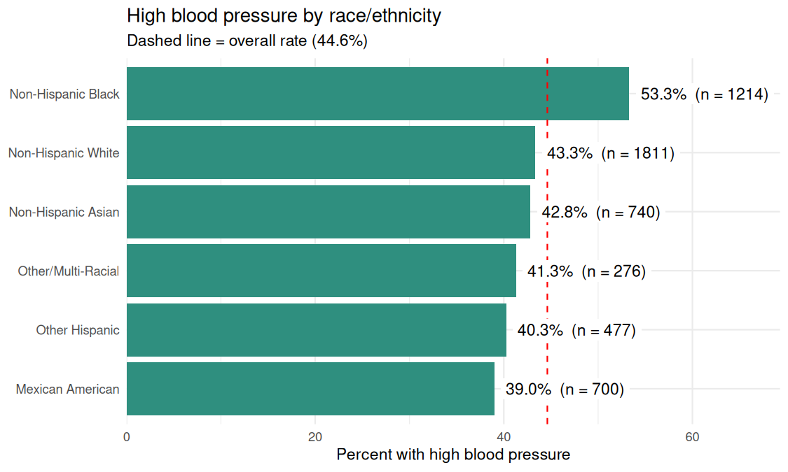{width=85%}

Non-Hispanic Black adults have the highest rate (53.3%), and Mexican American adults the lowest (39.0%). Race and ethnicity are social categories, not biological causes, and they stand in for differences in access to care, diet, stress and neighbourhood that this survey does not measure.

## Income

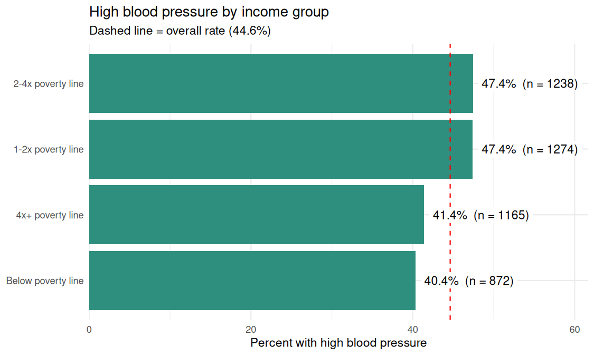{width=85%}

The pattern is not a straight line. The two middle income groups have the highest rates (47.4%), and both the richest and the poorest groups are lower.

## Smoking and physical activity

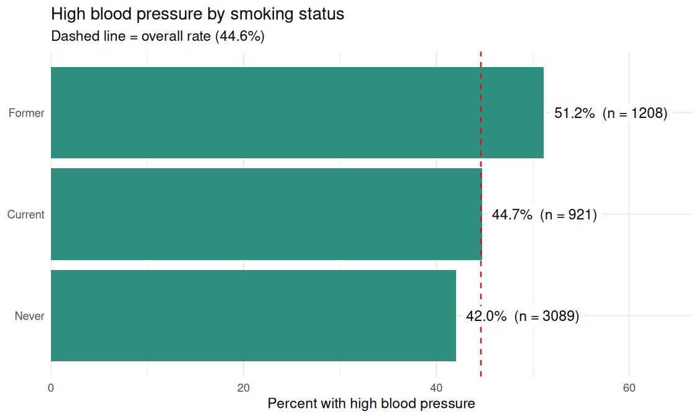{width=85%}

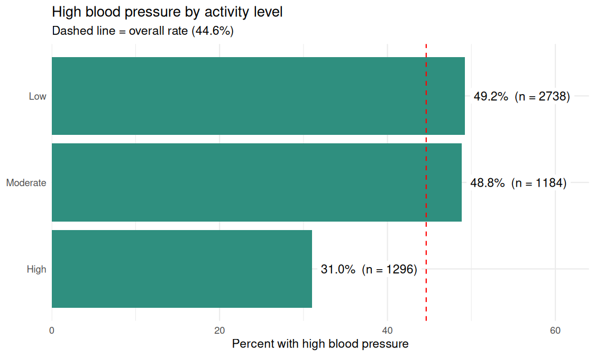{width=85%}

At first glance, these charts tell a simple story: highly active people have much lower rates (31.0%, against about 49% for the others). But age may be hiding a different explanation, as the next section shows. The tables below show the average age in each group.

```{r age-by-group}
kable(
  nhanes %>%
    filter(!is.na(activity_level)) %>%
    mutate(activity_level = factor(activity_level, levels = c("Low", "Moderate", "High"))) %>%
    group_by(`Activity level` = activity_level) %>%
    summarise(People = n(), `Average age (years)` = round(mean(RIDAGEYR), 1), .groups = "drop"),
  caption = "Average age by activity level."
)
```

```{r age-by-smoking}
kable(
  nhanes %>%
    filter(!is.na(smoking_status)) %>%
    mutate(smoking_status = factor(smoking_status, levels = c("Never", "Former", "Current"))) %>%
    group_by(`Smoking status` = smoking_status) %>%
    summarise(People = n(), `Average age (years)` = round(mean(RIDAGEYR), 1), .groups = "drop"),
  caption = "Average age by smoking status."
)
```

Groups can differ in age as well as in the factor we are looking at. This matters because age is so strongly linked to blood pressure that it can make an unrelated factor look important. Statisticians call this **confounding**: a hidden third factor creates an apparent link. The model in Section 8 deals with it by comparing people of the same age.

## How strongly do the numbers move together?

A **correlation** measures how closely two numbers move together. It runs from -1 to 1. A value near 0 means almost no straight-line relationship, and the further from 0, the stronger the link. Age has a correlation of **`r cor_age`** with high blood pressure and BMI has **`r cor_bmi`**: real but modest. (Systolic and diastolic pressure correlate much more strongly, but that is only because the outcome is built from them, so they cannot count as findings.)

# Ranked Findings

To separate the effects of each factor, we built a **logistic regression** model. In plain words, it is a standard method that estimates how much each factor changes a person's chances of having high blood pressure **while holding the other factors fixed**. For example, it compares two people of the same age, BMI and income who differ only in smoking status.

The model reports each factor as an **odds ratio**. **Odds** are the chance of something happening compared with the chance of it not happening. An odds ratio compares the odds between two groups:

- **1.0** means no difference.
- **Above 1** means higher odds of high blood pressure than the comparison group. For example, 1.5 means about 50% higher odds.
- **Below 1** means lower odds.

Each odds ratio comes with a **95% confidence interval**, a range of values consistent with the data. If the interval includes 1, the data do not clearly show any effect. The **p-value** measures how surprising the result would be if there were truly no effect. A p-value **below 0.05** is conventionally called **statistically significant**, meaning the effect is unlikely to be due to chance alone. It does **not** mean the effect is large or important.

For categories (such as smoking status), the model compares each group with a **reference group**: Never smoked, Low activity, Mexican American, and 1–2x the poverty line.

The table ranks every factor from the clearest effect to the least clear (smallest p-value first).

```{r ranked-factors}
term_labels <- tibble::tribble(
  ~term,                                   ~Factor,                        ~Compared_with,
  "RIDAGEYR",                              "Age (each additional year)",   "One year younger",
  "BMXBMI",                                "BMI (each additional point)",  "One point lower",
  "smoking_statusFormer",                  "Former smoker",                "Never smoked",
  "smoking_statusCurrent",                 "Current smoker",               "Never smoked",
  "activity_levelModerate",                "Moderate activity",            "Low activity",
  "activity_levelHigh",                    "High activity",                "Low activity",
  "race_ethnicityNon-Hispanic Asian",      "Non-Hispanic Asian",           "Mexican American",
  "race_ethnicityNon-Hispanic Black",      "Non-Hispanic Black",           "Mexican American",
  "race_ethnicityNon-Hispanic White",      "Non-Hispanic White",           "Mexican American",
  "race_ethnicityOther Hispanic",          "Other Hispanic",               "Mexican American",
  "race_ethnicityOther/Multi-Racial",      "Other/Multi-Racial",           "Mexican American",
  "income_group2-4x poverty line",         "Income 2–4x poverty line",     "Income 1–2x poverty line",
  "income_group4x+ poverty line",          "Income 4x+ poverty line",      "Income 1–2x poverty line",
  "income_groupBelow poverty line",        "Income below poverty line",    "Income 1–2x poverty line"
)

ranked <- tidy(model, exponentiate = TRUE, conf.int = TRUE) %>%
  filter(term != "(Intercept)") %>%
  arrange(p.value) %>%
  left_join(term_labels, by = "term") %>%
  mutate(
    Rank = row_number(),
    `Odds ratio` = round(estimate, 2),
    `95% confidence interval` = paste0(round(conf.low, 2), " to ", round(conf.high, 2)),
    `p-value` = scales::pvalue(p.value),
    `Clear effect?` = if_else(p.value < 0.05, "Yes", "No")
  ) %>%
  select(Rank, Factor, `Compared with` = Compared_with,
         `Odds ratio`, `95% confidence interval`, `p-value`, `Clear effect?`)

kable(ranked, caption = "Factors ranked by how clearly each is linked to high blood pressure.")
```

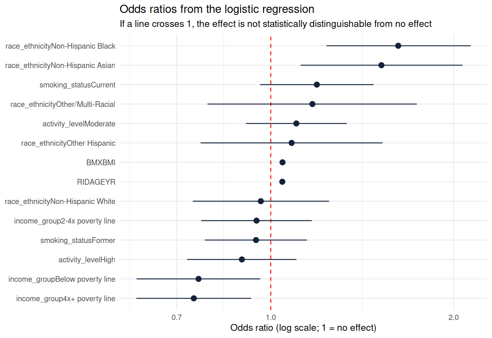{width=90%}

## What the ranking tells us

**1. Age (clearest effect).** Each extra year raises the odds by about `r round((get_or("RIDAGEYR") - 1) * 100)`%, which compounds to about `r round((age_decade - 1) * 100)`% higher odds per decade. Age is the dominant factor in this data.

**2. BMI.** Each extra BMI point raises the odds by about `r round((get_or("BMXBMI") - 1) * 100)`%, or about `r round((bmi_5pts - 1) * 100)`% for every 5 points. This is consistent with the well-established link between body weight and blood pressure.

**3. Non-Hispanic Black adults** had `r get_or("race_ethnicityNon-Hispanic Black")` times the odds of Mexican American adults (95% interval `r get_ci("race_ethnicityNon-Hispanic Black")`), even after accounting for age, BMI, smoking, activity and income.

**4. Non-Hispanic Asian adults** had `r get_or("race_ethnicityNon-Hispanic Asian")` times the odds (interval `r get_ci("race_ethnicityNon-Hispanic Asian")`) compared with the same group. The other race/ethnicity groups were not clearly different from Mexican American adults. These are comparisons with one reference group, not with everyone else, and they do not mean race itself causes high blood pressure.

**5. Income.** Adults at 4 or more times the poverty line had `r get_or("income_group4x+ poverty line")` times the odds of those at 1–2x (interval `r get_ci("income_group4x+ poverty line")`), and those below the poverty line had `r get_or("income_groupBelow poverty line")` times (interval `r get_ci("income_groupBelow poverty line")`). The first result matches what you might expect, but the second is surprising, and its interval ends close to 1. The 2–4x group was not clearly different. This pattern is irregular and we cannot explain it with this data, so it should not be read as poverty protecting against high blood pressure.

**6. Smoking and physical activity showed no clear effect.** Every interval for these factors includes 1. That is different from the raw charts, where highly active people looked much healthier and former smokers looked worse. Part of the reason is age: as the tables in Section 6 show, the groups differ in average age, and the model compares people of the same age. This does **not** prove that smoking and exercise are irrelevant to blood pressure. Our measures are simple, they rely on self-report, and a single survey cannot separate these effects well.

# The Predictive Model

## How the model was built

1. **Who was included.** `r fmt(n_model)` people. We excluded the `r fmt(n_income_missing)` people with missing income and the 60 with missing BMI, so that every person has every value the model uses.
2. **Training and testing.** We split people randomly into a **training set** (`r fmt(n_train)` people, 70%), used to build the model, and a **test set** (`r fmt(n_test)` people, 30%), kept aside to check the model on people it has never seen. Testing on the same people the model learned from would only measure memorization. We fixed the random seed so the split can be repeated exactly.
3. **What the model uses.** Age, BMI, smoking, activity, race/ethnicity and income group. We deliberately did **not** include blood pressure itself, because the outcome is defined from it, which would be cheating (called **data leakage**).
4. **How it predicts.** For each person the model produces a probability between 0 and 1. If it is **0.5 or higher**, we predict High; otherwise Low.

## How well does it work?

To judge accuracy, we need a yardstick. The **baseline** is the accuracy of a model that ignores everyone's details and always guesses the more common answer ("Low"). Any useful model must beat it.

```{r performance}
perf <- tibble::tribble(
  ~Measure,                                   ~Value,                  ~`What it means`,
  "Model accuracy",                           pct(accuracy),           "Share of test-set people the model classified correctly",
  "Baseline accuracy",                        pct(baseline),           "Accuracy of always guessing the more common answer (from the training set)",
  "Improvement over baseline",                paste0(round((accuracy - baseline) * 100, 1), " points"), "How much better the model is than guessing",
  "Catches true high blood pressure",         pct(sensitivity),        "Of people who really have high blood pressure, the share the model flags",
  "Correctly clears people without it",       pct(specificity),        "Of people who do not, the share the model correctly says are Low"
)

kable(perf, caption = "Model performance on the test set.")
```

The model beats guessing by about `r round((accuracy - baseline) * 100)` percentage points. That is a real improvement, but a modest one.

## Where does the model go wrong?

A **confusion matrix** counts the model's right and wrong predictions. The diagonal cells are correct. The other two are the two kinds of mistake.

```{r confusion-table}
cm_tbl <- data.frame(
  `Model said` = c("Low", "High"),
  `Actually Low` = c(tn, fp),
  `Actually High` = c(fn, tp),
  check.names = FALSE
)
kable(cm_tbl, caption = "Predictions against reality on the test set.")
```

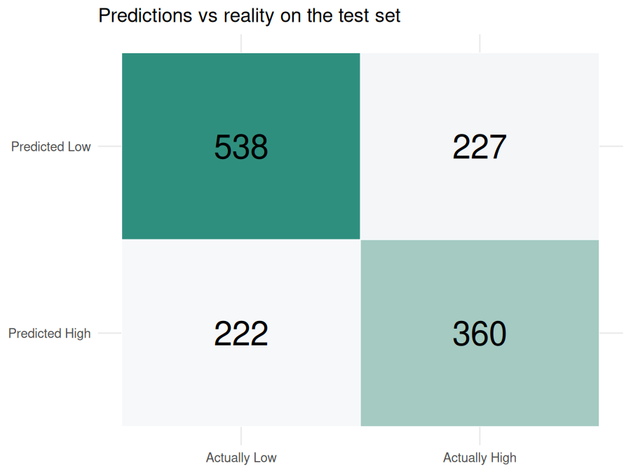{width=65%}

- **Missed cases (`r fn` people):** the model said Low, but the person actually has high blood pressure. In health screening, this is usually the more serious mistake.
- **False alarms (`r fp` people):** the model said High, but the person does not.

## Why isn't it more accurate?

The chart below shows the probability the model gave to people who truly have high blood pressure (top) and those who do not (bottom).

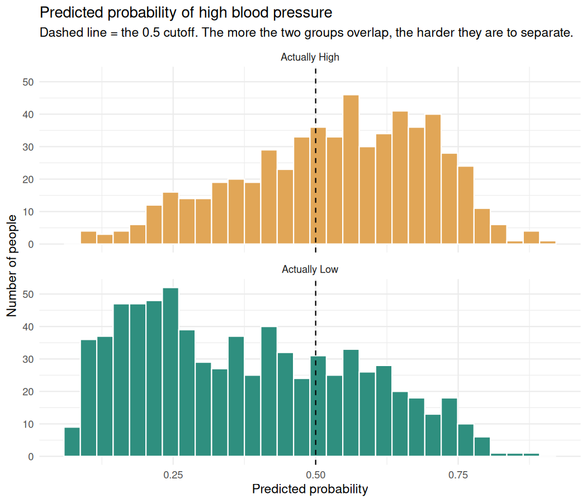{width=85%}

The two groups overlap heavily. Many people with high blood pressure received low probabilities, and many without it received high ones. The factors in this dataset, mainly age and BMI, shift the odds but cannot separate the two groups cleanly. Real blood pressure depends on many things this survey does not measure, such as diet, salt intake, family history, sleep, stress and medication. This is why we describe the model as a way to study patterns in this sample and not as a screening tool.

# Limitations

Each limitation is tied to a specific choice made earlier.

- **Unweighted analysis.** NHANES deliberately over-samples some groups so they can be studied reliably. We treated every respondent equally, so our rates describe this **sample**, not official national estimates. The overall 44.6% is close to the CDC's national figure, but group-level numbers may differ from the national picture.
- **Cross-sectional design.** Everyone was measured once, in 2017–2018. We can see which groups differ, but not what causes high blood pressure or how it changes over time.
- **Blood pressure measured, medication ignored.** A person with controlled blood pressure on medication counts as Low. The outcome means "elevated at the time of the exam", not "diagnosed with hypertension".
- **Self-reported lifestyle.** Smoking and physical activity come from questionnaires and may be inaccurate. The activity measure covers recreational activity only.
- **Missing income.** `r fmt(n_income_missing)` people (`r round(n_income_missing / n_final * 100, 1)`%) did not report income and were left out of the model. They may differ from those who did, so the income results describe people who reported income.
- **People lost in the merge.** 40.2% of the people first interviewed are not in our sample, because we required all five tables. Those lost may differ from those kept.
- **Zero diastolic readings.** 33 people have a diastolic reading of 0 mmHg. Treating those readings as missing would not have changed any label, but we cannot check them against a valid diastolic value.
- **One definition of high blood pressure.** We used 130/80. Under the older 140/90 guideline, fewer people would be labelled High and the results could change.
- **Modest prediction.** The model is correct about two times in three, and misses roughly four in ten people who truly have high blood pressure. It must not be used to assess any individual's health.

# Future Work

These extensions were considered but left out because of the time available for this project.

- **Missing income.** First compare people with and without a reported income, to see whether they differ. Then fit a second model with a separate "Not reported" income group as a robustness check, and try **multiple imputation**, a statistical method that fills gaps with plausible values while keeping track of the uncertainty. We rejected replacing missing incomes with 0 (it would treat 669 people as having no income) or with the average (it would pile them into one group and make the model seem more certain than it is).
- **Survey weights.** Use NHANES's sampling weights to produce national estimates.
- **Medication.** Include blood pressure medication, to match the clinical definition of hypertension.
- **More survey years.** Compare 2017–2018 with later NHANES cycles, with care: the 2017–March 2020 file overlaps with 2017–2018, so only independent cycles make a fair comparison.
- **Other factors and methods.** Add diet, sleep and family history, test whether factors interact, and try other models.

# Conclusion

Using real, measured data from `r fmt(n_final)` U.S. adults, we found that **age is the dominant factor linked to high blood pressure, followed by BMI**, with clear differences by race/ethnicity and an irregular pattern by income. **Smoking and physical activity were not clearly linked** once age and the other factors were taken into account, even though they looked different in the raw numbers. A model built from these factors beat a no-information baseline by about `r round((accuracy - baseline) * 100)` percentage points, which is a real but modest improvement. The most reliable lessons from this project are about **patterns and groups**, not about predicting any one person. Its strongest feature is that every step, from the CDC download to this report, is scripted, documented and repeatable.

# Glossary

| Term | Meaning |
|---|---|
| **Accuracy** | The share of predictions that were correct. |
| **Baseline** | The accuracy of always guessing the more common answer, with no information about the person. A useful model must beat it. |
| **BMI (body mass index)** | A measure of weight relative to height. Higher values mean more body weight for a given height. |
| **Confidence interval (95%)** | A range of values consistent with the data. If it includes 1 for an odds ratio, the effect is not clearly different from none. |
| **Confounding** | When a hidden third factor creates an apparent link between two others. For example, age can make activity look related to blood pressure. |
| **Confusion matrix** | A table counting a model's correct predictions and its two kinds of mistake (false alarms and missed cases). |
| **Correlation** | A number from -1 to 1 showing how closely two measurements move together. Near 0 means little relationship. |
| **Cross-sectional** | A study that measures people once, so it can show differences between groups but not causes or change over time. |
| **Data leakage** | Accidentally giving a model information that reveals the answer, such as using blood pressure to predict blood pressure. |
| **Diastolic pressure** | The bottom blood pressure number: pressure in the arteries between heartbeats. |
| **Histogram** | A chart that groups values into bins; the height of each bar shows how many people fall in that bin. |
| **Hypertension** | High blood pressure. Here: average systolic of 130 or more, or diastolic of 80 or more. |
| **Income-to-poverty ratio** | Household income divided by the poverty line for that household size. A value of 1 means income at the poverty line. |
| **Logistic regression** | A standard method that estimates how much each factor changes the chance of an outcome, while holding the other factors fixed. |
| **mmHg** | Millimetres of mercury, the unit of blood pressure. |
| **NHANES** | The National Health and Nutrition Examination Survey, run by the CDC, which combines interviews with physical examinations. |
| **Odds** | The chance of something happening compared with the chance of it not happening. |
| **Odds ratio** | The odds in one group divided by the odds in another. 1 means no difference; above 1 means higher odds; below 1 means lower. |
| **p-value** | How surprising a result would be if there were truly no effect. Below 0.05 is conventionally called statistically significant. It does not measure how large or important the effect is. |
| **Reference group** | The group every other group in a category is compared against (for example, "Never smoked"). |
| **Statistically significant** | Unlikely to be due to chance alone (by convention, p-value below 0.05). It does not mean large or important. |
| **Systolic pressure** | The top blood pressure number: pressure in the arteries when the heart beats. |
| **Test set / training set** | The training set is the group of people used to build a model; the test set is a separate group, kept aside, used to check it on people it has never seen. |
| **Unweighted** | Treating every survey respondent as equally important. Survey results are usually weighted to represent the whole population. |

# Reproducing This Report

All code and documentation are in the project repository. To rebuild everything from scratch, run these from the project's main folder:

```r
source("R/01-download.R")
source("R/02-merge-clean.R")
source("R/03-variables.R")
source("R/04-analysis.R")
rmarkdown::render("reports/report.Rmd")
```

The raw and cleaned data files are not stored in the repository, because the scripts recreate them. The scripts must be run before this report can be built.

| Where | What it holds |
|---|---|
| `R/` | The four pipeline scripts, in run order |
| `docs/data-quality-log.md` | What the data checks found |
| `docs/decisions.md` | Every choice made when building variables, and why |
| `docs/codebook/` | The CDC's own documentation for each data table |
| `output/figures/` | All figures used in this report |
| `output/` | Exported results (model coefficients, odds ratios, confusion matrix) |

# Sources

- Centers for Disease Control and Prevention, National Center for Health Statistics. *National Health and Nutrition Examination Survey (NHANES), 2017–2018.* https://wwwn.cdc.gov/nchs/nhanes/
- Ostchega, Y., Fryar, C. D., Nwankwo, T., & Nguyen, D. T. (2020). *Hypertension prevalence among adults aged 18 and over: United States, 2017–2018.* NCHS Data Brief, No. 364. National Center for Health Statistics.
- Whelton, P. K., et al. (2018). 2017 ACC/AHA/AAPA/ABC/ACPM/AGS/APhA/ASH/ASPC/NMA/PCNA guideline for the prevention, detection, evaluation, and management of high blood pressure in adults. *Hypertension, 71*(6), e13–e115.